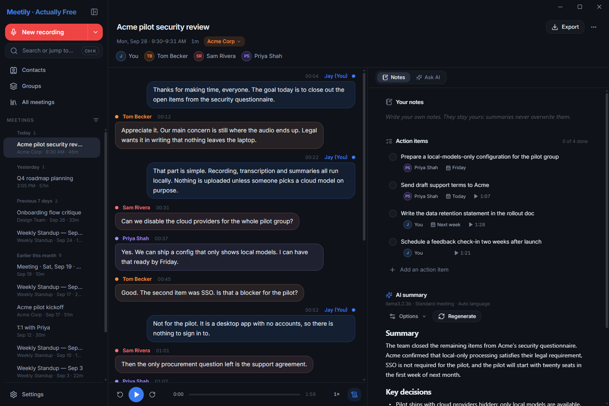

# Meetily – Actually Free

**Record meetings, transcribe them live, and turn the conversation into searchable notes and action items.** Meetily – Actually Free is a local-first desktop meeting assistant. It captures your microphone and computer audio directly, so no meeting bot needs to join the call. No app account, subscription, or license key is required.

[Project website](https://tylerbuza.github.io/Meetily-ActuallyFree/) · [Release notes](https://github.com/TylerBuza/Meetily-ActuallyFree/releases) · [Report an issue](https://github.com/TylerBuza/Meetily-ActuallyFree/issues) · [简体中文说明](README.zh-CN.md)

## Download

| Platform | Download | Choose this file |
| --- | --- | --- |
| Windows 10/11 x64 | [Windows release – Latest](https://github.com/TylerBuza/Meetily-ActuallyFree/releases/latest) | **Universal setup `.exe`** for a new installation. Setup selects CUDA, Vulkan, or CPU. The separate updater is for existing installations. |
| macOS 14.2+ · Apple Silicon (M1 or newer) | [macOS preview · v0.2.24](https://github.com/TylerBuza/Meetily-ActuallyFree/releases/tag/v0.2.24-macos) | **ARM64 `.dmg`**. Drag the app to Applications and grant microphone and Audio Capture access. The preview is not notarized. |
| Linux x86_64 · PulseAudio or PipeWire with `pipewire-pulse` | [Linux preview · v0.2.24](https://github.com/TylerBuza/Meetily-ActuallyFree/releases/tag/v0.2.24-linux-preview.1) | **CPU or Vulkan** `.deb` (Ubuntu 24.04 amd64) or `.AppImage` (compatible desktops). Start with CPU if unsure. |

On first launch, download a transcription model, select your microphone and computer-audio source, and check the input meters. For offline summaries, download a local summary model too. Windows setup may show **Unknown publisher**; the in-app updater has its own cryptographic signature. Checksums are on each release page.

## What you can do

- **Record or import.** Capture a live call with independent mic and system mute, gain, and level controls, or transcribe an existing audio file. Recordings can retain both source tracks and a mixed playback file. Use the floating bar to control a recording while you work elsewhere.
- **Transcribe and refine.** Use Parakeet or Whisper locally. Keep the live transcript or rerun transcription after the call with a different model. Vocabulary hints help with recurring names, acronyms, and project terms.
- **See who spoke.** Mic audio is labeled **You** by source. Pyannote/WeSpeaker or optional Nemotron-3 distinguishes speakers in computer audio. Rename or merge labels, including individual names on overlapping turns. Optional **voice profiles (beta)** let you teach a named contact’s voice for suggestions in later meetings; review matches yourself.
- **Review and follow up.** Jump from a timestamp to the recording. Keep your notes beside an editable AI summary, ask questions about the meeting, and assign action items with owners and due dates. Choose a summary template and output language.
- **Organize and find.** Group related meetings, browse a contact’s meeting history, and search meetings, people, transcripts, summaries, and tasks with **Ctrl/Cmd+K**.
- **Export.** Save one or more meetings as **PDF, Word, Markdown, text, or JSON**. The single-meeting Markdown exporter supports YAML frontmatter and optional Obsidian links for named speakers.

The workspace includes Midnight, Vanilla, and Charcoal themes. [See the live recording screen](docs/images/v0.2.18/live-recording.png) or [browse the meeting library](docs/images/v0.2.18/meeting-workspace.png) in the demo screenshots.

**Platform-specific and experimental features:** Windows can capture several chosen apps; macOS supports one running app at a time. The Linux preview captures a selected output. Optional Labs settings include waveform scrubbing, Clean/Verbatim transcript views, Whisper silence filtering, and Windows Parakeet encoder acceleration via DirectML. On Windows, meeting detection can prompt you; optional automation requires an eligible mic or camera signal to start recording.

## What stays local?

With local models installed, **recording, transcription, speaker labeling, and summarization can run offline**. Recordings, models, and the meeting database live on your device. No usage analytics are transmitted.

For summaries, use the built-in local model runner or a local Ollama server. You can instead configure a cloud provider with your own key or use an installed, signed-in Claude Code CLI. Cloud transcription sends audio to the provider; cloud summaries send meeting text. External services have their own privacy terms and may charge. See the [privacy policy](PRIVACY_POLICY.md).

Change where audio is saved under **Settings → Recording → Save Location**. The mixed recording (`audio.mp4`) and separate source tracks (`mic.mp4`, `system.mp4`) are distinct from the database that holds your meeting notes and transcripts.

## What changed over time?

- [**0.2.17**](docs/RELEASE_V0217.md) added optional Nemotron speaker labeling during and after calls.
- [**0.2.18**](docs/RELEASE_V0218.md) brought the meeting workspace, contacts, groups, action items, multi-meeting export, per-app capture, and opt-in Labs features.
- [**0.2.20**](docs/RELEASE_V0220.md) improved recording continuity and model setup. [**0.2.23**](docs/RELEASE_V0223.md) improved overlapping speaker labels, Markdown exports, and post-call processing.
- [**0.2.24**](docs/RELEASE_V0224.md) improved device-format handling, audio timing at Stop, participant counts, and interrupted-recording recovery. Windows, Apple Silicon, and Linux downloads have separate release notes above.

## Development and credits

The desktop app uses Tauri 2, Rust, and React/Next.js. Start with the [development map](docs/DEVELOPMENT_MAP.md) and [contributor guide](AGENTS.md). Platform references: [Windows builds](frontend/scripts/build-universal-windows.ps1) · [macOS builds](.github/workflows/MACOS_RELEASE.md) · [Linux source and build guide](https://github.com/TylerBuza/Meetily-ActuallyFree/blob/feat/linux-support/docs/building_in_linux.md).

Maintained by [Tyler Buza](https://github.com/TylerBuza). This independent, [MIT-licensed](LICENSE.md) fork builds on [Meetily by Zackriya Solutions](https://github.com/Zackriya-Solutions/meetily). The [release notes](https://github.com/TylerBuza/Meetily-ActuallyFree/releases) credit the contributors and reporters behind each update and link the upstream changes adapted here.
