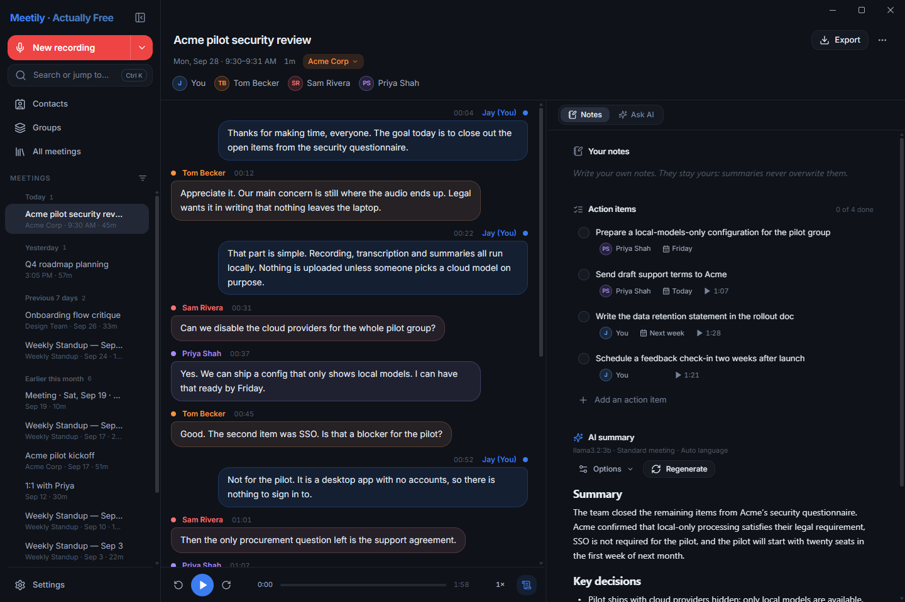

# Meetily – 真正免费

**录制会议、实时转写，并把对话变成可搜索的笔记和行动项。** Meetily – 真正免费是一款本地优先的桌面会议助手。它直接捕获你的麦克风和电脑声音，因此不需要让会议机器人加入通话。无需应用账号、订阅或许可证密钥。

[项目主页](https://tylerbuza.github.io/Meetily-ActuallyFree/) · [发行说明](https://github.com/TylerBuza/Meetily-ActuallyFree/releases) · [反馈问题](https://github.com/TylerBuza/Meetily-ActuallyFree/issues) · [English README](README.md)

## 下载

| 平台 | 下载 | 选择哪个文件 |
| --- | --- | --- |
| Windows 10/11 x64 | [Windows 版本 – 最新](https://github.com/TylerBuza/Meetily-ActuallyFree/releases/latest) | 全新安装请选**通用安装程序 `.exe`**。安装程序会让你选择 CUDA、Vulkan 或 CPU。单独的更新程序只用于已有安装。 |
| macOS 14.2+ · Apple Silicon（M1 或更新） | [macOS 预览版 · v0.2.24](https://github.com/TylerBuza/Meetily-ActuallyFree/releases/tag/v0.2.24-macos) | **ARM64 `.dmg`**。把应用拖到“应用程序”文件夹，并授予麦克风和音频捕获权限。该预览版未经过公证。 |
| Linux x86_64 · PulseAudio，或带 `pipewire-pulse` 的 PipeWire | [Linux 预览版 · v0.2.24](https://github.com/TylerBuza/Meetily-ActuallyFree/releases/tag/v0.2.24-linux-preview.1) | **CPU 或 Vulkan** `.deb`（Ubuntu 24.04 amd64）或 `.AppImage`（兼容桌面环境）。不确定时先用 CPU 版。 |

首次启动时，请下载一个转写模型，选择麦克风和电脑声音来源，并检查输入电平。如需离线摘要，还要下载本地摘要模型。Windows 安装程序可能显示**未知发布者**；应用内更新程序有独立的加密签名。每个发行页面都提供校验和。

## 可以做什么

- **录制或导入。** 以独立的麦克风/系统静音、增益和电平控制录制一通实时通话，也可以转写已有的音频文件。录制可以同时保留两个原始音轨和一个混合播放文件。你在别处工作时，可以用悬浮条控制录制。
- **转写与修正。** 在本地使用 Parakeet 或 Whisper。保留实时转写，或在通话结束后用其他模型重新转写。词汇提示有助于处理反复出现的人名、缩写和项目术语。
- **区分谁在说话。** 麦克风音频按来源标记为**你**。Pyannote/WeSpeaker 或可选的 Nemotron-3 会区分电脑声音中的发言人。你可以重命名或合并标签，包括为重叠发言中的个别姓名命名。可选的**声纹档案（测试版）**可以让你教应用记住某位联系人的声音，并在之后的会议中给出建议；是否采纳由你判断。
- **回顾与跟进。** 从时间戳跳转到录音。把笔记放在可编辑的 AI 摘要旁边，就会议内容提问，并为行动项指派负责人和截止日期。可以选择摘要模板和输出语言。
- **整理与查找。** 将相关会议分组，浏览某位联系人的会议历史，并用 **Ctrl/Cmd+K** 搜索会议、人物、转写内容、摘要和任务。
- **导出。** 把一场或多场会议保存为 **PDF、Word、Markdown、文本或 JSON**。单场会议的 Markdown 导出支持 YAML frontmatter，并可为已命名发言人添加 Obsidian 链接。

工作区提供 Midnight、Vanilla 和 Charcoal 三种主题。[查看实时录制界面](docs/images/v0.2.18/live-recording.png)或[浏览会议库](docs/images/v0.2.18/meeting-workspace.png)的演示截图。

**平台相关与实验性功能：** Windows 可捕获多个指定应用；macOS 一次只支持一个正在运行的应用。Linux 预览版捕获选定的输出设备。可选的“实验室”设置包括波形拖动、精简/逐字转写视图、Whisper 静音过滤，以及通过 DirectML 加速 Windows 上的 Parakeet 编码器。在 Windows 上，会议检测可以提示你；可选的自动化需要有效的麦克风或摄像头信号才会开始录制。

## 哪些内容留在本地？

安装本地模型后，**录制、转写、说话人标注和摘要都可以离线运行**。录音、模型和会议数据库都保存在你的设备上。不会发送使用情况统计。

摘要可以使用内置的本地模型运行器或本地 Ollama 服务器。你也可以配置自己的云服务密钥，或使用已安装并登录的 Claude Code CLI。云端转写会把音频发送给服务商；云端摘要会发送会议文本。外部服务有自己的隐私条款，并可能收费。参见[隐私政策](PRIVACY_POLICY.md)。

在**设置 → 录制 → 保存位置**中可以更改音频保存位置。混合录音（`audio.mp4`）和分开的原始音轨（`mic.mp4`、`system.mp4`）与存放会议笔记和转写内容的数据库是分开的。

## 版本变化

- [**0.2.17**](docs/RELEASE_V0217.md) 新增通话中与通话后的可选 Nemotron 说话人标注。
- [**0.2.18**](docs/RELEASE_V0218.md) 带来会议工作区、联系人、分组、行动项、多会议导出、按应用捕获，以及需要手动开启的实验室功能。
- [**0.2.20**](docs/RELEASE_V0220.md) 改进了录制连续性与模型设置。[**0.2.23**](docs/RELEASE_V0223.md) 改进了重叠发言人标签、Markdown 导出和通话后处理。
- [**0.2.24**](docs/RELEASE_V0224.md) 改进了设备格式处理、停止时的音频时序、参会人数统计和中断录制恢复。Windows、Apple Silicon 和 Linux 的下载各有独立的发行说明，见上文链接。

## 开发与致谢

桌面应用使用 Tauri 2、Rust 和 React/Next.js。请先阅读[开发地图](docs/DEVELOPMENT_MAP.md)和[贡献者指南](AGENTS.md)。平台参考：[Windows 构建](frontend/scripts/build-universal-windows.ps1) · [macOS 构建](.github/workflows/MACOS_RELEASE.md) · [Linux 源码与构建指南](https://github.com/TylerBuza/Meetily-ActuallyFree/blob/feat/linux-support/docs/building_in_linux.md)。

由 [Tyler Buza](https://github.com/TylerBuza) 维护。这个独立的、[MIT 许可](LICENSE.md)的分支基于 [Zackriya Solutions 的 Meetily](https://github.com/Zackriya-Solutions/meetily)。[发行说明](https://github.com/TylerBuza/Meetily-ActuallyFree/releases)会列出每次更新的贡献者和问题反馈者，并链接此处采用的上游改动。
